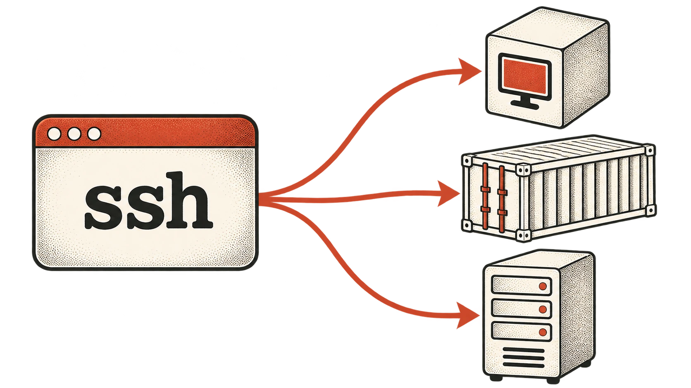
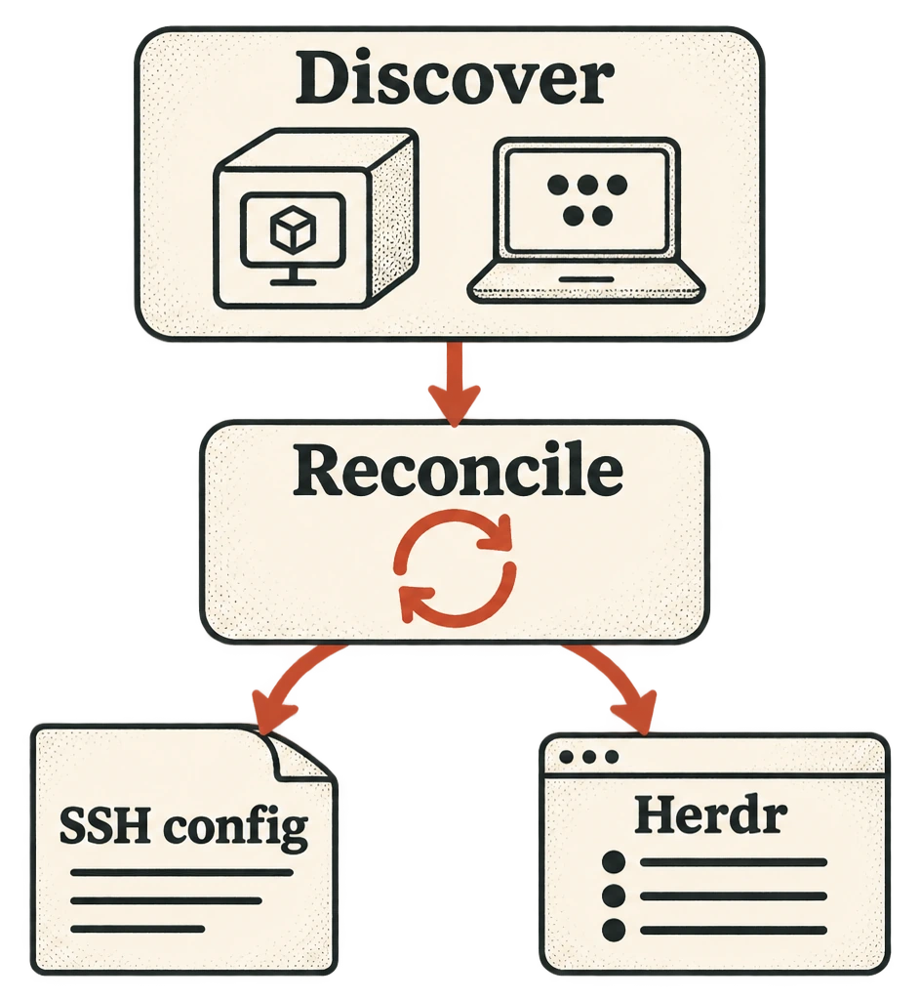

This week I've learned some crazy stuff about SSH. I've been working a lot with various cloud platforms as well as a local k3s cluster I've been setting up. It has been annoying managing all the different connection methods to get into my various forms of compute so I thought I might make a tool to make it easier. While researching, I learned two incredible SSH config tricks that have some really impressive potential.

The two tricks are:

- `~/.ssh/config` accepts imports!
- The `ProxyCommand` directive

The takeaway? With these two tricks and a little vibe-coding I was able to make a really cool little binary that automatically keeps my KubeVirt VMs and tagged Tailscale machines available in SSH and Herdr! More on that later.

<figure class="article-figure">
  <a href="/images/hwatch-cover.webp">
    
  </a>
  <figcaption>One SSH interface, different connection routes. <a href="/images/hwatch-cover.webp">Open full-size illustration</a>.</figcaption>
</figure>

## Imports in Your Config

So `~/.ssh/config` accepts imports, huh? That is crazy. It is actually very simple.

You just write something like

```
Include "my-additional-config-file"
```

Now, assuming you have an SSH config file located at `~/.ssh/my-additional-config-file`, it will be discovered automatically!

One important caveat: an included file can end inside a `Host` or `Match` block. Adding `Host *` after the `Include` starts a new block that matches all hosts. It doesn't repair syntax errors or reset options SSH has already assigned.

The full setup should look like

```
Include "my-additional-config-file"
Host *

Host remote-pc
    HostName remote-pc
    User myname
    IdentityFile ~/.ssh/id-file
    IdentitiesOnly yes
```

## What is ProxyCommand?

I discovered this one totally on accident. I was researching Herdr remote machine access and my agent helpfully suggested using the `ProxyCommand` directive.

Evidently SSH provides `ProxyCommand` as a way to make it so that SSH can delegate the connection work to another command. Incredible. This allows you to connect to a machine using a different mechanism but still treat it like an SSH command. What does that look like?

`ProxyCommand` supplies a byte stream to an SSH server; SSH still handles the SSH connection, host-key checking, and authentication. The pod/container examples below need both an SSH server and `nc` inside the target, plus permission to run the relevant `exec` command. They don't turn an arbitrary pod shell into SSH.

```
# SSH into a kubevirt VM in a k3s cluster
Host devbox-k3s
    User jacob
    ProxyCommand virtctl --context my-k3s port-forward --stdio=true vm/devbox/dev %p

# Accessing a regular Kubernetes pod
Host dev-pod
    User jacob
    ProxyCommand kubectl --context my-k3s -n dev exec -i dev-pod -- nc 127.0.0.1 %p

# SSH into a docker container
Host dev-container
    User jacob
    ProxyCommand docker exec -i dev-container nc 127.0.0.1 %p

# Cloudflare access
Host lab1-away
    HostName ssh.example.com
    User jacob
    ProxyCommand cloudflared access ssh --hostname %h

# An AWS EC2 instance
Host ec2-box
    HostName i-0123456789abcdef0
    User ec2-user
    ProxyCommand sh -c "aws ssm start-session --target %h --document-name AWS-StartSSHSession --parameters 'portNumber=%p'"
```

For the AWS example, replace the placeholder instance ID and use the SSH username for your instance. You'll also need the Session Manager plugin, a managed instance configured for SSH over Session Manager, and the required IAM permissions.

These configurations now allow you to just run SSH like you normally would and connect to those machines even though they each need different tools to invoke their connection. Amazing! You can do `ssh ec2-box` and you are there!

## Let's Use This For Good!

Now I want to bring this together to make something useful. Herdr allows us to add machines to our terminal by running a command like `herdr machine add ssh-config-name`. Once you do that it shows up in Herdr's sidebar.

I'm currently working on setting up my local k3s cluster and have made it so it can spin up kubevirt VMs for various purposes. Wouldn't it be great if Herdr knew about these automatically as they popped in and out of existence?

What if I made a tool that...

- Polled the cluster for VMs with a certain label
- When it polled it would write the list of VMs to an SSH file that is included in your main config
- Reconciles changes in state
	- New VMs get `herdr machine add machine-name`
	- Missing VMs get `herdr machine remove profile-id`

And just like that you can have dynamic VM allocation that Herdr just "knows" about.

<figure class="article-figure">
  <a href="/images/hwatch-reconcile.webp">
    
  </a>
  <figcaption>Conceptual flow: discover machines and reconcile their SSH configuration and Herdr entries. <a href="/images/hwatch-reconcile.webp">Open full-size diagram</a>.</figcaption>
</figure>

So I built it! I present to you [hwatch](https://github.com/jbeers/herdr-watch). A tool for automatically adding/removing VM connections in SSH and Herdr. It currently has support for Tailscale and k3s/kubevirt. There's also a Herdr plugin; the repository has setup instructions. Give it a shot!