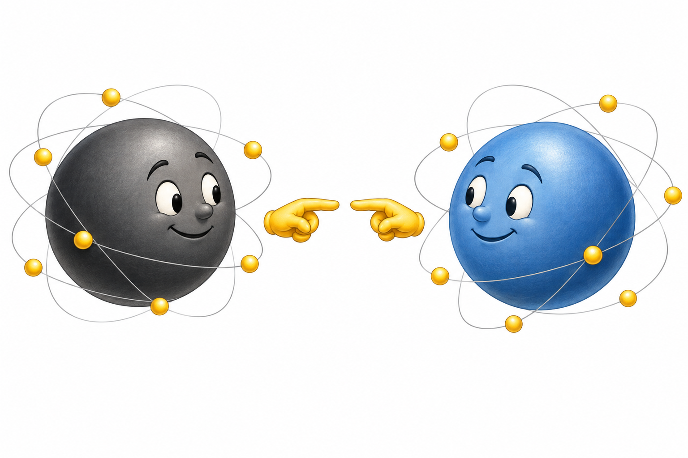
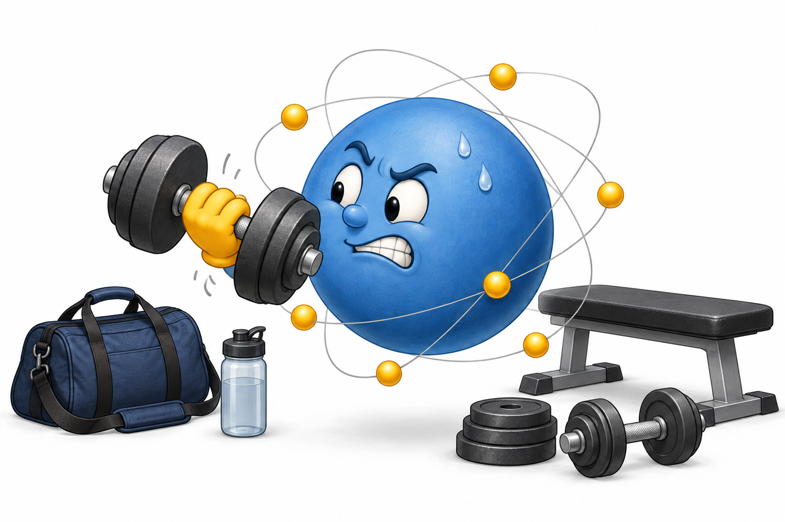

You never really touch anything.

Have you heard that phrase before? Some people think it sounds profound. It's kind of profound, I guess. It's not that I disagree with it, really, I just think it is a bit sensational.

They usually mean something like "our molecules don't actually come into contact; electromagnetic forces repel each other before the molecules reach one another." To me, all that means is that "touching" something is just a different mechanic than we originally imagined. Instead of molecules rubbing up against each other, it is electrons with a bit of space and force mixed in.

<figure class="article-figure">
  
</figure>

## You Can't Just Decide to Lift 315

At any rate, that isn't actually what I want to write about today. The real thing I want to write about is outcomes. This phrase just popped into my head and became a helpful analogy.

Lately, I've been thinking a lot about the struggle it is to produce the thing we want. I want to bench press 3 plates on each side of the bar. 315 pounds. Sheer force of will will not allow me to walk over to my weight rack and press 315 casually. You never really touch anything.

<figure class="article-figure">
  
</figure>

I'm not without hope, though! While I can't just decide to lift the weight, I can create a schedule, follow it consistently, eat properly, get rest, and some number of months or years later, I will have gotten stronger!

Hooray! Now I can lift 315, right? Maybe, maybe not. There are many factors that might determine if I hit my goal. Genetic factors, training method, injury, etc. 315 is an attainable but lofty goal for many people. On a case-by-case basis, it isn't necessarily clear who will be able to accomplish that feat. Anyone can try; not everyone can achieve it. You never really touch anything.

## Agency Without Certainty

That isn't to say that I have no agency. I really can improve my strength by choices and actions. I can change my world. What I can't do is reach out and grab whatever I want. It takes time and effort to achieve what I fix my will on. It requires process and effort to pursue an uncertain outcome.

What is the connection between "touch" and our goals? To reach out and take hold of what you want isn't as simple as it seems. You can't just reach out and touch it. You always have to do something else. Want to get stronger? Commit to a workout plan. Want to prove your professional value? You need to produce it and communicate it. Want to make beautiful art that touches someone's soul? You need to experience good art.

## Success Is Sticky

You can't reach out and touch whatever you want, but you can draw near to your goal. You can't just grab success, but it does seem like success is sticky. You show up somewhere 60 days in a row, and all of a sudden you realize that lifting the weights isn't as hard as it used to be. Maybe you can eke out a few extra pull-ups. Somewhere along the way, strength just stuck to you. Was it day 13? Maybe day 26? 54? Who knows.

Realizing that we can't just reach out and "touch" success is discouraging at first, but it reveals a strategy that actually works. While you can't control success, you can optimize for exposure to success.

In summary, maybe the idea that you never really touch anything is more profound than I originally gave it credit for. You may not be able to reach out and take hold of whatever you want, but you can open up your shell, position yourself in range, and let electromagnetism bring you electrons. It may not be what we normally think of as "touching," but it's as real as it gets.